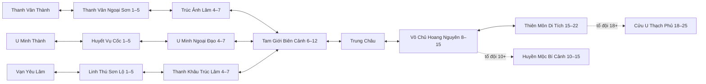

# World Progression — world_catalog_15_v1

Triển khai 28–29/10/2026 trên repo Phase 7, không tạo project mới. Người dùng đã cho phép dùng địa hình mẫu Phase 7 để dựng và kiểm thử năm map bổ sung. Không thêm art; giữ hình khối và sprite thử Kiếm Tu hiện có.

## Trạng thái bàn giao

- **A — DONE:** import nguyên bản `world-content-15-v1.json`, validator và `MapContentRegistry`; đúng 15 canonical map IDs, 57 ID archive có trạng thái PLANNED_DISABLED. Bản đề xuất gốc vẫn giữ enabled=false; cấu hình đã review nằm trong `world15-bindings.json` và runtime JSON, không tự kích hoạt bản nháp.
- **B — DONE:** bốn thành an toàn không có quái, ba start field và ba mid field có geometry, cổng, safe camp/checkpoint, normal groups và elite. Hai tài khoản mỗi tộc đã đi tuyến thật, hạ quái/elite và claim quest.
- **C — DONE:** Biên Cảnh/Trung Châu/Hoang Nguyên; ba tuyến nhập môn nhập lại, dùng hệ khảo hạch chín thế lực cấp 10 hiện có. Đã kiểm tra sai tộc, không đổi thế lực, kỹ năng/path và claimed flags qua relogin.
- **D — DONE:** Huyền Mộc cấp 10 và Cửu U cấp 18 có controller riêng theo dữ liệu, wave 4 / 4 / boss; boss cấp 15 và 25 có phase. Giữ ledger thưởng V3. Cửu U có một wipe và cooldown 15 phút từ lúc bắt đầu, lưu trong progress, không mất khi logout/restart.
- **E — DONE:** Sổ tay, discovery, gợi ý quest/map, inspector local/admin; Java 21 Docker 75 unit tests, transport 7 tests, frontend production build và các kịch bản thật đã đạt. Lượt 20 client và phạm vi/các lần cleanup nằm ở [WORLD15_PERFORMANCE](WORLD15_PERFORMANCE.md).

Danh sách map/quái/boss/quest đã bật và validation output: [WORLD15_VALIDATION.json](WORLD15_VALIDATION.json). Receipt kiểm thử đã lọc: [world15-20261029.txt](test-results/world15-20261029.txt); số liệu đo tải: [world15-load-20261029.json](test-results/world15-load-20261029.json). Không kèm token, mật khẩu hay backup DB trong repo.

## Danh mục và ID

API `/api/world/maps` trả đúng 15 map content: ba thành tộc, sáu field riêng, Trung Châu, ba field chung, hai dungeon. Hai arena nội bộ của duel/training vẫn tồn tại để giữ Phase 6/7, được loại khỏi catalog thế giới này.

`mapId` trong catalog là canonical ID của file được cung cấp. `id`/`runtimeMapId` dùng ID đã triển khai: ví dụ `thanh_van_thanh` → `thanh-van`, `huyen_moc_bi_canh` → `huyen-moc-party`. Mười ID cũ không bị đổi trong save; năm map mới dùng ID underscore. Ánh xạ đầy đủ ở `backend/src/main/resources/world15-bindings.json`. Không có bảng map cần hard-delete; `characters.map_id` và progress/checkpoint cũ vẫn đọc được.

57 map planned cũ không được tạo runtime hoặc xuất thành active. Save trỏ map không tồn tại/archived/private bị sửa về thành/checkpoint hợp lệ, giữ EXP, realm, organization/path và inventory. Khi nâng version một field có level đề xuất cao hơn level save cũ, người chơi được đưa về checkpoint an toàn. Đã thử cả unit và một save PostgreSQL thật trên tài khoản QA có thế lực/đồ/quest đã nhận thưởng.

## Tuyến chính



Đây là tuyến content chính. Cổng/shortcut Phase 7 đang hoạt động vẫn được giữ, gồm thành ↔ Trung Châu, field cũ ↔ Biên Cảnh và Trung Châu/Biên Cảnh ↔ Di Tích cấp 10. Khoảng level đề xuất không phải mọi cổng đều là hard gate. Quest chain kiểm tra điều kiện riêng. Cổng vào dungeon không teleport trực tiếp: phải xác nhận tổ đội qua controller; rời dungeon trả về anchor cũ. Huyền Mộc còn giữ điểm vào Trung Châu để tương thích.

Tất cả tọa độ sinh từ geometry đã được review/validate, không lấy tọa độ null từ proposal. Cổng chính và cổng về có target spawn hợp lệ, không đặt người trong solid. Player/monster/NPC dùng cùng Movement/Navigation; graph designer không bảo đảm actor có thể đi mọi cạnh nếu capability không đạt.

## Quái, boss và scheduler

- Có **34 species**, **31 normal spawn groups**, **12 boss placements** đúng ID đề xuất. Runtime có 94 combat definitions: legacy templates và biến thể theo từng level. `speciesId` giữ monsterId canonical, `definitionId` là biến thể; slot chọn level trong dải của group, không do client chọn.
- Có **145 slot quái mở**, gồm 135 normal, 9 elite, 1 slot World Boss theo lịch; dungeon groups chỉ được controller tạo trong instance. MaxAlive là theo map-instance; slot giữ UUID qua respawn. Tắt enabled không tạo entity.
- Chỉ map/scope có người hoặc lease grace được mô phỏng AI/physics. Map vắng giữ slot và mốc thời gian; khi có người quay lại, respawn quá hạn xử lý một lần. AOI vẫn lọc packet/rendering, không dùng client quyết định spawn/aggro/damage/drop.
- Huyền Mộc Yêu Vương chỉ được đặt ở Huyền Mộc encounter. Template BOSS cũ còn trong CombatCatalog để tương thích test/save/alias, không còn placement ngoài Di Tích. Placement và instance ID tham gia quest/reward validation.
- Hoang Nguyên Cự Thú: cửa sổ 20 phút đầu mỗi chu kỳ 4 giờ UTC (00/04/08/12/16/20), cần người online cấp 8+ ở Hoang Nguyên. Chỉ một boss mỗi cycle; chết không respawn lại trong cùng cửa sổ. Hết cửa sổ despawn và bỏ cast/target/threat. Cảnh báo sự kiện là map-wide, entity state vẫn theo AOI.
- V4 có unique `(event_key, cycle)` trong PostgreSQL để reserve cycle trước spawn. Restart trong cùng cycle không sinh lại boss đã được reserve; encounter World Boss không resume qua restart, chờ cycle sau. Đã test clock/eligibility/death/expiry/restart bằng clock giả và test unique SQL thực. Chưa quan sát một trận World Boss tự mở đúng cửa sổ thật trong lượt này; không ghi thành live-event battle PASS.

## Quest và tiến trình

Giữ chín quest Phase 7, thêm 37 definition đã review từ 38 seeds: `hunt_tam_gioi_bien_canh` liên kết WOLVES, không tạo bản sao “giết 5 Yêu Lang”. Tổng **46 quest definitions**. WOLVES/PATH giữ ID, claimed flags, reward/counters cũ. RUINS_KING cũ chuyển mục tiêu về đúng Huyền Mộc, vẫn công nhận bộ đếm Di Tích cũ nếu đã hoàn thành trước cập nhật.

Quest hỗ trợ requiredRace/level, prerequisite AND/OR, follow-up, nhiều objective, map/species/group/placement. Validator chặn ID trùng, vòng lặp và reference sai. DISCOVER_MAP, KILL_MONSTER, DEFEAT_BOSS_PLACEMENT, CLEAR_DUNGEON_WAVE có credit từ server. Claim kiểm tra đủ mọi objective, serialize qua world lock và đợi transaction; claim lại trả lỗi, không grant lần hai. Đối luyện không credit quest/reward.

Ba tuyến mới dùng Guide ở map tương ứng, thoại lấy story notes của proposal; quest và reward đã được review trong generator. PATH cấp 10 gọi đúng tổ chức/khảo hạch cũ, không thêm chọn nghề khi tạo nhân vật. Discovery maps/species và quest-objective counters lưu trong progress JSON có default cho save cũ. Nội dung mới dừng ở cấp 25; EXP không nâng nhân vật mới vượt 25, không hạ level nhân vật cũ đã cao hơn.

Player không được đánh từ vùng protected để farm quái trong khi miễn sát thương. Heal/dash vẫn dùng được; guard AI giữ policy riêng. Không mở PvP ngoài duel.

## API, WS và UI

- JWT: `/api/world/maps`, `/maps/{mapId}`, `/maps/{mapId}/monsters`, `/monsters/{monsterId}/locations`. Map metadata không trả navigation/waypoints/bot routes. Không trả drop RNG, token hoặc seed.
- Owner JWT: `/api/characters/{id}/world-journal` có 15 map, 34 species, discovered flags và next quests/locked reason. Chỉ server cập nhật discovery; đọc Sổ tay không tự mở map.
- Giữ protocol 3 AOI baseline/delta, epoch/version/resync và protocol 1/2 compatibility. Thêm `WORLD_BOSS_STARTED/ENDED` map-wide; phase/telegraph/combat vẫn theo scope/AOI. Không replay gameplay khi reconnect.
- Dungeon commands thêm `dungeonId` khi chọn/list/READY, giữ HUYEN_MOC default tương thích. Kết quả/activities có dungeonId/name/mapId, lịch sử DB phân biệt HUYEN_MOC/CUU_U. Ledger cũ vẫn unique theo run/character/reward.
- Chức năng hoặc Map → **Sổ tay Map / Quái / Boss**: lọc map/tier/level, đã đến/đã gặp, boss đúng vùng, gợi ý quest tiếp theo. Phó bản tổ đội có selector hai dungeon và điều kiện vào/cooldown. Không thêm art.
- Inspector `/api/dev/content` chỉ profile local + loopback + JWT + X-Dev-Key; chỉ đọc catalog, zone/reference chưa cấu hình và entity counts. UI dev nhập key tạm, không lưu; production endpoint vắng mặt. Công cụ level QA 1–25 có cùng bảo vệ, không có nút cấp level cho người chơi.
- Metrics thêm activeMaps/simulatedMonsterSlots/activeNpcEntities và p50/p95/p99/window max. `sinceTick` chọn mẫu sau baseline, bộ đệm bounded 20.000 tick (~16 phút 40 giây ở 20 Hz). Đây là thời gian thân simulate, không phải latency end-to-end hoặc thời gian chờ world lock/broadcast.

## Kiểm chứng đã chạy

- Docker Java 21: **75/75 unit tests**; TypeScript/Vite production build; transport **7/7**.
- `world15-routes.mjs`: sáu user, hai mỗi tộc; nhập môn/mid/elite thật, WOLVES một lần, hội ngộ, Level 10 tổ chức/path/skill, chống sai tộc/đổi thế lực và persistence. Level 10 dùng dev grant bảo vệ để kiểm tra nhanh; đoạn nhập môn không fake kill.
- `dungeon.mjs`: hai party, hai Huyền Mộc instance, ba wave thật, phase/telegraph, reconnect, forged scope, unique grants và safe return.
- `world15-dungeon.mjs`: Cửu U thực ở level 18, hai nhóm quái + boss 25, reconnect cùng instance, thưởng một lần, cooldown sau relogin/lập lại party, equipment và realm breakthrough persist.
- `world15-catalog.mjs`: đúng 15, alias, bốn thành 0 spawn, locations, journal ownership/discovery persist, quest dedup/locks và keyed inspector.
- `world15-archived-save.mjs`: cập nhật map archived trên đúng QA character đã có thế lực trong PostgreSQL, join fallback giữ level/EXP/cultivation/org/path/items và WOLVES/PATH đã claim.
- Hồi quy Docker `multiplayer`, `maps`, `bots`, `duel`, `production` đạt. Maps test dùng checkpoint cuối từ data vì đã thêm trại phía đông; không hardcode trại 1970 làm điểm cuối.
- Flyway V1–V4 validate/upgrade trên DB game cũ; image mới khởi động thành công trên DB trắng riêng, V1–V4 đều success, 0 users. Test DB/container tạm đã dọn. SQL hai claim cùng cycle cho kết quả INSERT 1 rồi INSERT 0, count=1, transaction rollback.
- Browser: lọc đủ 15 vùng/boss bí cảnh, trạng thái đã gặp, selector Huyền Mộc/Cửu U và cooldown hiển thị đúng, không có console error. Ảnh `.tools/world15-journal-ui.png`; tab QA đã rời game/đóng trước đo tải.

Các script Phase 7 còn giả định quái trong town (`combat`, `ecology`, `party`, `reconnect`, `progression`, các load cũ) là fixture lịch sử, không dùng làm acceptance cho catalog này. Hồi quy combat/reward/party/progression hiện được thực thi bằng routes/dungeon/catalog ở trên cùng domain tests. Không ghi những script lịch sử chưa chuyển đổi thành PASS.

## Chạy và rollback

Chạy game như README. Runtime đọc `maps.json`, `combat.json`, `bots.json`, `progression.json`, `dungeons.json`; source proposal và bindings giữ truy vết. Nếu cần build lại content đã review:

```powershell
python scripts/build-world15-content.py --enable-world-boss
```

Generator đọc baseline Phase 7 trong `docs/content-history/phase7`, ánh xạ ID và geometry đã được người dùng cho phép. Không chạy tự động khi server khởi động. Bỏ flag world boss giữ placement/quest đó disabled; không tự bật một event chưa có controller. Sau sửa data phải chạy validator/tests và restart backend.

V4 chỉ thêm world_event_cycles; V1–V3 giữ nguyên. Quest/discovery/cooldown mới nằm trong JSON aggregate, không cần bảng riêng. Backup trước V4 nằm ở `.tools/world15-before-release.dump` (private, gitignore), chưa xóa volume. Khi rollback release cần dừng server và dùng code/config/DB backup tương ứng; không chỉ copy maps.json vì dungeon/quest/binding references phải khớp. Không chạy restore/drop trên DB người dùng khi chỉ muốn thử cấu hình. Không sửa checksum migration đã apply.

## Giới hạn

Một process/world lock, JSON delta ở cấp entity, graph/ground AI và placeholder visuals. Chưa có test dài nhiều giờ, benchmark latency client, full solo playthrough tự nhiên 1→25 hay xác nhận balance mọi tổ hợp. Lượt dungeon QA dùng cấp dev được bảo vệ, combat/kill/reward vẫn thật. Lease/party/practice không khôi phục qua restart; checkpoint vẫn có cửa sổ 15 giây. World Boss reserve chống duplicate nhưng không tiếp tục boss đang sống sau restart. Cấp 26–100 và 57 map archive là NOT_STARTED có chủ ý, ngoài phạm vi bản này. Các giới hạn này không được trình bày như nội dung đã hoàn thành.

- **PARTIAL về kiểm chứng:** balance/natural playthrough toàn tuyến 1–25 và trận World Boss trong cửa sổ lịch thật; có cấu hình/controller và test mục tiêu, chưa có chứng nhận trải nghiệm dài hạn.
- **NOT_STARTED:** nội dung 26–100, kích hoạt 57 planned maps, bang hội/giao dịch/Tam Tộc Chiến và mở rộng nhiều node; nằm ngoài catalog đang bàn giao.
